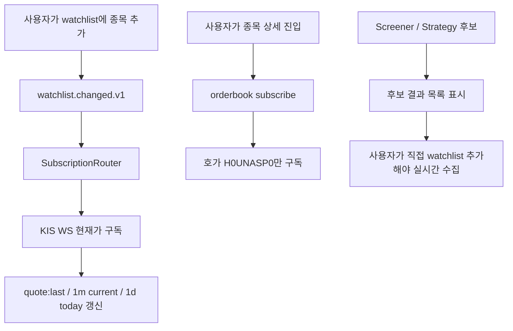
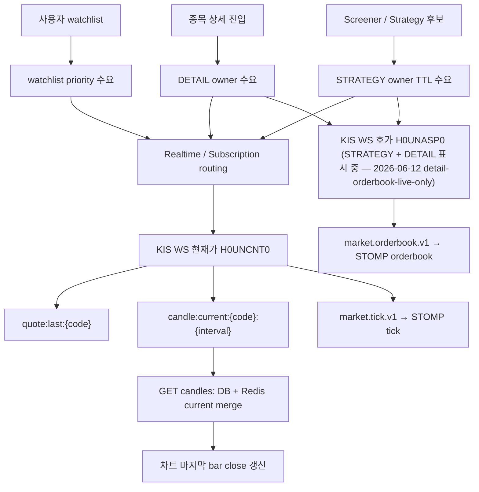
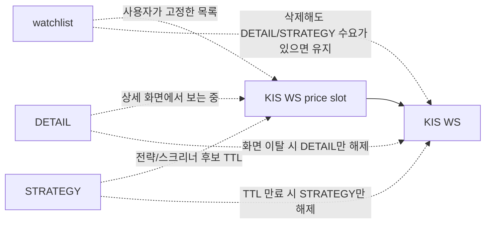
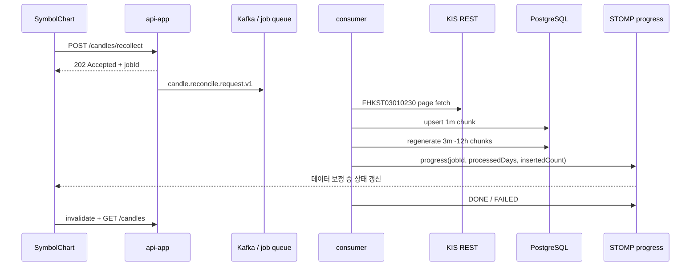

# 캔들 데이터 정책

- 작성일: TBD
- 2026-05-11 갱신: **ADR 0057 KIS-only data source 정합** — Yahoo Finance 전면 폐기. 본 문서 §3·§4·§5·§6 매트릭스 KIS-only로 재정의.
- 2026-05-11 amend: ADR 0019 supersede 인용 제거 → **Accepted (Yahoo 의존 부분만 보류)**. 5m~1h은 **1m 합산 가공 방향 확정** (backlog §31 트랙 — 위치·source 결정 대기). credential 정책: 정보 수집은 prod 단일 채널 (모의/실전 분기는 주문 라우터 한정).
- 2026-05-11 amend: **ADR 0062 plan 발행** — 5m·15m·30m·90m·1h 합산 가공 위치(권장안 A-1 백엔드 precomputed) + source 시간 범위(권장안 옵션 2 과거 포함 30 거래일) + IntervalToggle 5종 활성화(15m·90m 추가) plan 발행. 사용자 결정 후 본 문서 매트릭스 5m~1h 행을 "1m 합산 가공 예정" → "1m 합산 가공 (백엔드 precomputed)" 갱신 예정.
- 2026-05-12 갱신 (v3.2.3 doc cut — backlog §35): **§3 매트릭스 5m~1h 행 "1m 합산 가공 (백엔드 precomputed)" 갱신** (ADR 0062 Accepted 2026-05-11) + **§3·§6 매트릭스에 NXT 통합 시각 cover 08:00~20:00 KST 통합** (ADR 0063 Accepted) + **§4 IntervalToggle 5종 활성화 갱신** + **§6 cold-start 흐름 AggregateBackfillRunner 호출 인용** (PR #303) + **§7 당일 진행 중 캔들 흐름 20:00 KST DailyCloseFinalizer 갱신** (PR #303) + **mock 합성 금지 정합** (`feedback_no_mock_data.md` 인용).
- 2026-05-20 갱신 (ADR 0091): **KOSPI=UN/KOSDAQ=J market-level 분기 폐기**. NXT 후보 종목(`is_kospi200` 또는 `is_kosdaq150`)은 `UN` 우선 + `J` fallback, 그 외는 `J` 기본값. *(→ 2026-06-09 ADR 0118 amend로 전종목 `J` 단일화·`UN` 분기 완전 폐기.)*
- 2026-05-31 갱신: **3m·4h·12h 합산 interval 정규 편입 + 사용자 재수집(recollect) path 추가**. 스크리닝은 야간 전용이 아니라 사용자가 언제든 실행하는 기능이며, 1차 broad screening 기본 기준봉은 1d, 2차/사용자 선택 기준봉은 1m·3m·5m·15m·30m·90m·1h·4h·12h·1d·1wk·1mo·1y 중 선택 가능. 잘못 모인 캔들은 mock 보정 없이 DB row 삭제 후 KIS 원천 재수집, 합산봉은 1m 재수집 후 `CandleAggregator` 재생성.
- 2026-05-31 갱신: **실시간 수요 owner 분리**. Watchlist는 사용자 고정 목록, SymbolDetail은 `DETAIL` owner, Screener/Strategy 후보는 `STRATEGY` owner TTL 수요다. 후보군을 watchlist에 자동 합치지 않는다. 장중 현재가·모든 기준봉 마지막 close는 KIS WS tick 기반 Redis current candle이 권위다.
- 2026-06-12 갱신 (anchor `detail-orderbook-removal`): **종목 상세 호가 구독 제거** — 호가는 전략 ACTIVE 매매 경로(STRATEGY owner) 전용으로 단일화. (※ 아래 `detail-orderbook-live-only`로 부분 복원됨.)
- 2026-06-12 재결정 (anchor `detail-orderbook-live-only`): **종목 상세 호가를 "표시 중에만" 방식으로 부분 복원**. 수동매매 시 호가 없이 주문하면 안 된다는 최고 관리자 결재. 옛 LRU 10 slot·debounce·5분 idle 잔류 방식이 아니라 **진입 시 구독 / 이탈 즉시 해제**(현재 보는 종목만 슬롯 점유 — 보기용 합집합 잠식 차단). 호가 owner는 ① STRATEGY(전략 ACTIVE, marketable limit 진입가 산정) ② DETAIL(종목 상세 표시 중) 두 경로다. 같은 종목을 두 owner가 요구하면 단일 호가 구독을 공유하고 모든 owner가 빠질 때만 unsub(F11 패턴). EXIT 누락(브라우저 강제 종료) 대비 DETAIL 호가 한정 15분 idle 안전망(현재가 DETAIL grace 5분보다 길게). `OrderbookSubscriptionRouter`는 STRATEGY + DETAIL 두 owner를 추적한다.
- 2026-06-13 갱신: **호가 WS를 H0UNASP0 통합 호가로 전환**. KRX-only 호가는 퇴역하고, `H0UNASP0` 1채널로 KRX+NXT 호가와 예상체결 필드를 수신한다.
- 2026-06-09 갱신 (ADR 0118 amend): **REST `fid_cond_mrkt_div_code` 전종목 `J`(KRX 본시장) 단일화**. ADR 0091의 NXT 후보 `UN` 우선 분기 폐기 — `UN`/`NX` 일봉이 KIS측 결함으로 2026-02-11 stale 동결되어 일부 종목 일봉이 영구 동결된 근본 원인. `J`만 전 종목 항상 최신. trade-off로 일봉 거래량 NXT 분 제외(본시장만). **REST 시장구분 `J` 단일과 WS 통합(H0UNCNT0 체결가·H0UNASP0 호가)은 별개 축** — WS는 통합 채택, REST는 `J` 단일. §3·§6 매트릭스 `J` 단일 반영.
- 2026-05-31 갱신 (ADR 0105): **캔들 Reconciliation + 장기 1m 보관/복구 정책**. 1m은 기본 최근 6개월 거래일, admin/manual 최대 1년을 목표로 하고, 지난 gap은 KIS `FHKST03010230`로 복구한다. 자동매매는 data readiness `READY`가 아니면 전략 평가와 주문 발행을 skip/fail-closed 한다.
- 2026-06-01 갱신 (ADR 0105 amend): **실전 운용 시나리오 acceptance matrix 추가**. A→B→A 재진입 gap fill, 3일 off 후 boot managed universe reconciliation, 3일 1m gap 자동 복구+합산봉 재생성, 1년 초과 1m 복구 불가, 자동매매 data readiness fail-closed, 장기 backfill progress streaming 원칙을 LOCK.
- 2026-06-01 갱신: **합산 interval boundary 문서/구현 NXT 통합 재정렬**. 3m·5m·15m·30m·90m·1h·4h·12h boundary는 KRX 09:00~15:30 고정이 아니라 NXT 통합 08:00~20:00 기준이다. KRX-only 종목은 해당 구간에 실제 1m tick/bar가 없으면 빈 구간으로 남기며 mock 합성하지 않는다.
- 2026-06-01 구현 반영: **ADR 0105 1차 reconciliation 코드 연결**. `SymbolDetailMinuteGapFillService`가 상세 진입 시 1m gap fill을 큐잉하고, `CandleBootstrapRunner`는 managed universe를 대상으로 reconciliation을 시작한다. 1m gap fill 성공 후 합산봉은 `AggregateBackfillRunner`가 upsert로 재생성하며, `RealtimeSignalGenerator`는 data readiness `READY`가 아니면 `SIGNAL_SKIPPED_DATA_NOT_READY`로 fail-closed 한다.
- 2026-06-01 보강 구현: **SymbolDetail 1m range gap fill 정밀화**. 상세 진입 path는 더 이상 장기 lookback backfill worker를 직접 호출하지 않고, `KisOneMinuteCandleRangePort.fetchOneMinuteCandlesBetween(code, lastDb+1m, previousMinute)`로 필요한 범위만 조회한다. 저장 source는 `KIS-RANGE-GAPFILL`, 삽입 발생 시 3m~12h 합산봉을 재생성한다.
- 2026-06-01 보강 구현: **range gap fill fail-closed**. `KisOneMinuteCandleRangePort`의 credential/token/rate-limit/HTTP 실패는 empty candle이 아니라 upstream 실패로 보고 예외로 전파한다. `SymbolDetailMinuteGapFillService`는 upstream 실패 또는 합산봉 재생성 실패를 `FAILED` readiness로 닫아 자동매매 평가/주문이 준비되지 않은 데이터 위에서 진행되지 않게 한다.
- **2026-06-09 갱신 (ADR 0119 — 1분봉 proactive cold-start 백필 폐지 → on-demand 전환)**: `ColdStartExecutor`(126일 1m + 1d·1wk·1mo·1y 5종 fetch)를 전면 은퇴하고 그 트리거 3곳(`CandleBootstrapRunner` cold-start 분기 · `WatchlistChangedKafkaListener` · `LastCandleAtMonitor` 1m stale)을 제거했다. **1m 수집 정책 = 실시간 WS(`TickToMinuteAggregator`, 구독 종목 ~30) + on-demand(`SymbolDetailMinuteGapFillService` 차트 진입 bounded gap fill · `CandleBackfillWorker` admin 수동) 만. proactive 미리 끌어오기 0.** 일봉/주봉/월/년봉은 전종목 일봉 universe(R-BF/R2 · ADR 0118)가 담당. `LastCandleAtMonitor`의 일봉(ONE_DAY) stale 감지 + `CandleBackfillWorker(ONE_DAY)` + Slack 알림은 한국석유 회귀 가드로 **유지**. `KisRestCandleAdapter`의 1m 126일 lookback은 on-demand admin backfill이 공유하므로 보존(제거 시 on-demand 깨짐). 배경: 일봉 wipe(ADR 0118 R-BF)가 managed 전체에 1m cold-start storm(126 거래일×~630콜/종목) 유발 incident.
- 본 문서는 운영 가이드. 결정 본문은 **ADR 0057 (KIS OpenAPI 단일 데이터 출처)** + **ADR 0062 (합산 interval 백엔드 precomputed)** + **ADR 0063 (NXT/통합거래 cover)** + **ADR 0019 (Accepted, 2026-05-12 §2 재통합)** + **ADR 0028 (Watchlist Ingestion)** + **ADR 0029 (당일 진행 중 캔들 Redis 캐시)** + **ADR 0048 (KIS WS 41 slot + polling fallback)** + **ADR 0105 (캔들 Reconciliation + 장기 1m retention)** 참조.

## 1. 정책 한 줄 요약

> **KIS OpenAPI 단일 출처 (prod credential 단일 채널). REST 시장구분 = 전종목 `J`(KRX 본시장) 단일 — `UN`/`NX` KIS측 stale 동결로 deprecated(ADR 0118 amend). DB 영속 = KIS 원천 candle + 1m 기반 합산 candle. 1m 수집 = 실시간 KIS WS(구독 종목만) + on-demand(차트 진입 bounded gap fill·admin 수동 backfill) — proactive cold-start 백필 0 (ADR 0119). 일봉/주봉/월/년봉 = 전종목 일봉 universe(R-BF/R2·ADR 0118). 장중 실시간 = KIS WS owner 수요(`HOLDING`/`PENDING_BUY`/`STRATEGY`/`DETAIL` — 체결가 H0UNCNT0 통합 단일 채널·ADR 0124) + Redis `candle:current:{code}:{interval}`. watchlist는 WS 미점유·5초 REST polling 전용(ADR 0124). Yahoo Finance 폐기. Mock 합성 금지 (`feedback_no_mock_data.md`).**

## 2. 핵심 원칙

1. **KIS OpenAPI 단일 출처** — Yahoo Finance·네이버 금융 등 보조 출처 폐기 (ADR 0057, 사용자 결정 2026-05-11)
2. **정보 수집 = prod credential 단일 채널** — 모의/실전 분기는 주문 라우터 한정 (사용자 명시 정책 정정 2026-05-11)
3. **수요 owner 분리** — Watchlist는 사용자 고정 목록이다. SymbolDetail 진입은 `DETAIL`, Screener/Strategy 후보는 `STRATEGY` owner로 KIS WS 실시간 수요를 낸다. 후보군을 watchlist에 자동 삽입하거나 단순 합집합으로 slot을 계산하지 않는다.
4. **DB가 진실원 + Redis는 진행 중 현재봉** — 1m은 ADR 0105 기준 기본 6개월, admin/manual 최대 1년을 목표로 한다(Phase 1 전 legacy 구현은 30거래일). 3m·5m·15m·30m·90m·1h·4h·12h은 1m 기반 백엔드 precomputed, 1d·1wk·1mo·1y는 KIS 원천으로 영속한다. 장중 마지막 bar close는 Redis `candle:current:{code}:{interval}`가 KIS WS tick으로 갱신한다.
5. **slot은 owner-aware priority/TTL** — KIS WS 가격 slot은 watchlist priority, DETAIL high priority, STRATEGY TTL priority를 함께 보되 해제 책임을 owner별로 분리한다.
6. **3m·5m·15m·30m·90m·1h·4h·12h = 백엔드 precomputed 합산 (ADR 0062 §3 권장안 A-1 확장)** — `CandleAggregator` 도메인 본체(Pure Kotlin) + `AggregateBackfillRunner` cold-start trigger. MCP·룰엔진·백테스트·스크리너 동일 source 정합
7. **REST `fid_cond_mrkt_div_code` 전종목 `J` 단일 (ADR 0118 amend)** — `UN`/`NX` KIS측 stale 동결 근본 fix로 종목 분기 폐기. 1m 베이스는 본시장 390 bar/일 기준(NXT 분 제외). `MIN_1M_CANDLE_THRESHOLD`는 본시장 기준으로 평가. *(역사: ADR 0063·0091은 NXT cover 위해 `UN` 후보를 썼으나 deprecated.)*
8. **Mock 합성 금지** — backend 0건/에러 시 "데이터 없음" 명시 표시 (사용자 메모리 `feedback_no_mock_data.md` — 2026-05-11 dogfooding 사용자 결정)
9. **공식 일봉 마감값 > WS tick 집계 (ADR 0118 Proposed)** — today 1d 봉의 최종 권위는 **공식 마감값**(20:05 저녁 + 08:05 장전 멀티시세 snapshot `FHKST11300006` 또는 검증용 `FHKST03010100`)이다. 장중 WS tick 집계로 만든 today 1d 봉은 마감 후 snapshot이 `upsertAll`(ON CONFLICT DO UPDATE)로 교정한다. today **이전** 일봉은 immutable(ON CONFLICT DO NOTHING) 유지.
10. **MARKET_DAILY universe ≠ active managed universe (ADR 0118 Proposed·결재 완료 2026-06-09)** — 전종목(**~3,000 보통주, ETF·ETN 제외 — 결재 ①**) 일봉 적재용 `MARKET_DAILY` universe(`instrument` 테이블 기반·1d 단독·**KIS WS 구독 0**)는 active managed universe(~25, ADR 0105)와 물리 분리된다. 저녁/장전 멀티시세 snapshot(30종목/콜·~100콜/run, 20:05 today + 08:05 직전 영업일 재확정)으로 대상일 1d만 적재(이력 깊이와 무관하게 run당 호출 수 고정). **최초 backfill 이력 깊이 = 10년(~2,450 거래일·~7.3M row·파티셔닝 불필요 — 결재 ②)**, 멱등 분산 캠페인(~75,000콜·여러 밤/주말). 스크리너 후보 산출의 raw 데이터일 뿐 **watchlist에 자동 삽입하지 않는다**(원칙 3 정합). 1d gap 복구 universe = MARKET_DAILY catch-up(listed_at clamp로 신규 상장 false gap 0), 1m gap 복구 universe = active(현행 유지). **MARKET_DAILY 10년 이력 깊이는 active universe 1m/1d retention(6개월~1년, ADR 0105)과는 별개 축**이다(혼동 금지).

## 3. 데이터 매트릭스 (ADR 0057·0062·0063 정합)

> **2026-05-12 갱신 (v3.2.3 doc cut)**: 5m~1h 행 "백엔드 precomputed 합산" 채택안 명시 + NXT cover 시각 통합 매트릭스 + KOSPI/KOSDAQ market 분기 명시.

| Interval | Source (KIS tr_id) | Cache | DB 영속 | 시각 cover | TTL/만료 |
|---|---|---|---|---|---|
| **틱** | KIS WS `H0UNCNT0`(KRX+NXT 통합 단일 채널·`NEW_MKOP_CLS_CODE` 세션 구분 — ADR 0124) + 시간외 `H0STOUP0` | Redis `quote:last:{code}` + Kafka/STOMP | X | NXT 통합 08:00~20:00 KST + 시간외 단일가 | quote TTL 7d |
| **1m (1분봉) — 당일** | KIS WS tick → Redis current, closing 시 DB INSERT. REST `FHKST03010200`은 backfill/검증 | Redis `candle:current:{code}:1m` | DB INSERT (분 단위 closing) | NXT 통합 08:00~20:00 KST (720 bar/일) | Redis: 2m |
| **1m (1분봉) — 장기 backfill/reconciliation** | KIS REST `FHKST03010230` (`J` 단일 — ADR 0118 amend) | Redis (당일 current) | **DB 영속 (기본 6개월, 최대 1년; `magicjar.candle.one-minute.*`)** | NXT 통합 08:00~20:00 KST | — |
| **3m·5m·15m·30m·90m·1h·4h·12h** | **백엔드 precomputed 합산** + 장중 KIS WS tick current candle | Redis `candle:current:{code}:{interval}` | **DB 영속 (1m retention 기준 재생성)** | NXT 통합 08:00~20:00 KST boundary 정렬 | Redis: 24h |
| **1d (일봉)** | KIS REST `FHKST03010100` (period='D', `J` 단일 — ADR 0118 amend) + **전종목 야간 멀티시세 snapshot `FHKST11300006` (30종목/콜, today 교정 — ADR 0118)**. MARKET_DAILY 최초 backfill 이력 깊이 = **10년**(~2,450 거래일, listed_at clamp) | Redis cache (옵션) | **DB 영속 (today=공식값 `upsertAll`, 과거봉 immutable · MARKET_DAILY ~7.3M row·파티셔닝 불필요)** | **NXT 종가 통합 권위 (20:00 KST 마감 기준 — 결재 ③ LOCK)**. 멀티시세 NXT 반환 여부 R2 raw 실측, 정규장만 시 DailyCloseFinalizer 폴백 | — |
| **1wk (주봉)** | KIS REST `FHKST03010100` (period='W', `J` 단일 — ADR 0118 amend) | Redis cache (옵션) | **DB 영속** | — | — |
| **1mo (월봉)** | KIS REST `FHKST03010100` (period='M', `J` 단일 — ADR 0118 amend) | Redis cache (옵션) | **DB 영속** | — | — |
| **1y (년봉)** | KIS REST `FHKST03010100` (period='Y', `J` 단일 — ADR 0118 amend) | Redis cache (옵션) | **DB 영속** | — | — |
| **진행 중 1d·1wk·1mo·1y** | KIS WS tick 누적 (REST는 backfill/마감 검증) | Redis `candle:current:{code}:{interval}` (`1d` legacy `candle:today` 병행) | **마감 후 DB INSERT/검증** | NXT 마감 20:00 KST | interval별 TTL |

### 3-A. 합산 interval source 매트릭스 (CandleAggregator precomputed)

| Interval | 1m 합산 단위 | NXT cover bar/일 | 30 거래일 legacy row 추정 |
|---|---|---|---|
| 3m | 3건 | 240 (08:00~19:57) | ~7,200 / 종목 |
| 5m | 5건 | 144 (08:00~19:55) | ~4,320 / 종목 |
| 15m | 15건 | 48 (08:00~19:45) | ~1,440 / 종목 |
| 30m | 30건 | 24 (08:00~19:30) | ~720 / 종목 |
| 90m | 90건 | 8 (08:00·09:30·11:00·12:30·14:00·15:30·17:00·18:30) | ~240 / 종목 |
| 1h | 60건 | 12 (08:00~19:00) | ~360 / 종목 |
| 4h | 240건 | 3 (08:00·12:00·16:00) | ~90 / 종목 |
| 12h | 720건 | 1 (08:00) | ~30 / 종목 |
| **합계 합산 8종** | — | — | **~14.4K rows / 종목** |

위 표는 ADR 0062 당시 30거래일 legacy 산출 기준이며, 합산봉 overhead를 보기 위한 참고치다. ADR 0105 이후 장기 1m 보관 규모는 아래 §3-B를 기준으로 한다.

### 3-B. 1m 장기 보관/복구 estimate (ADR 0105)

| 기준 | 6개월(약 126 거래일) | 1년(약 252 거래일) |
|---|---:|---:|
| KRX 정규장 390 bar/day | 약 49K rows/종목 | 약 98K rows/종목 |
| NXT 통합 720 bar/day | 약 91K rows/종목 | 약 181K rows/종목 |
| `FHKST03010230` calls/day | KRX 4 / NXT 6 | KRX 4 / NXT 6 |
| 안전 cap | 8 pages/day | 8 pages/day |
| NXT 1년 worst call | — | 약 1.5K calls, safety cap 기준 약 2.0K calls |

전체 universe 1년 1m 수집은 부팅 동기 작업이 아니다. boot는 queue 등록까지만 수행하고, backfill/reconciliation worker가 KIS 10 TPS budget 안에서 BACKFILL/INGESTION_LOW priority로 분산 처리한다.

## 4. UI 버튼 (ADR 0057·0062 정합)

> **2026-05-31 갱신**: 3m·4h·12h까지 포함한 합산 interval 전체를 IntervalToggle과 스크리너 기준봉 선택지에 노출.

```
분봉: [1m] [3m] [5m] [15m] [30m] [90m] [1h] [4h] [12h]  ← 1m 직접 수집 + 백엔드 precomputed 합산
일봉: [1d] [1wk] [1mo] [1y]                              ← KIS REST 전체 기간
```

1d·1wk·1mo·1y·1m은 KIS가 직접 제공 → **합성 0**. 3m·5m·15m·30m·90m·1h·4h·12h은 **백엔드 precomputed 합산** (CandleAggregator 도메인 본체). 모든 클라이언트(REST API·MCP·룰엔진·백테스트·스크리너) 동일 source 참조.

차트에는 일반 갱신(upsert)과 별도로 재수집 버튼을 둔다. 재수집은 사용자가 확인한 경우에만 현재 선택 interval row를 삭제하고 KIS 원천을 다시 수집한다. 합산봉 재수집은 1m 원천을 함께 재수집한 뒤 합산봉을 다시 생성한다.

## 5. KIS REST 한도 (ADR 0037 + 0057 정합)

| Interval | KIS endpoint / tr_id | 한도 |
|---|---|---|
| 1m (당일) | `FHKST03010200` | 당일 한정 — 1회 호출당 30건 / 페이징 가능 |
| 1m (과거 일별 분봉) | `FHKST03010230` | 실전계좌 — 1회 호출당 120건 / 날짜+시간 cursor / KIS 서버 보관 최대 1년 |
| 1d·1wk·1mo·1y | `FHKST03010100` | 1회 호출당 100건 / 페이징 (FID_INPUT_DATE_1·FID_INPUT_DATE_2 범위) |
| 현재가 | `FHKST01010100` | 1회 호출당 1건 |

**Rate Limit (ADR 0037)**: 초당 10건 토큰 버킷 + 우선순위 큐 (사용자 path > Watchlist Ingestion > backfill).

**`FHKST03010230` (KIS 1분봉 과거 데이터)**: prod credential 단일 채널 호출. 1m 기본 6개월/최대 1년 영속 + 3m·5m·15m·30m·90m·1h·4h·12h 합산 source로 활용한다. KIS 공식 샘플 기준 1회 최대 120건, `FID_INPUT_DATE_1` + `FID_INPUT_HOUR_1` cursor, 서버 보관 최대 1년.

## 6. 1m 수집 흐름 (ADR 0028 §2-3 + ADR 0062·0063 + ★ ADR 0119 cold-start 폐지)

> **2026-05-12 갱신 (v3.2.3 doc cut — PR #303·#304 구현 인용)**: halt/liquidation skip + market 분기 + AggregateBackfillRunner 호출 + 1m 30 거래일 페이지네이션 명시.
> **2026-05-31 갱신**: watchlist는 cold-start 트리거 중 하나일 뿐, 실시간 구독의 유일한 source가 아니다. SymbolDetail·Strategy/Screener 후보는 watchlist INSERT 없이 별도 KIS WS 수요를 낸다. ADR 0105 Phase 1에서 1m cold-start/reconciliation target은 기본 6개월, 최대 1년으로 확장한다.
> **★ 2026-06-09 갱신 (ADR 0119 — proactive cold-start 백필 폐지)**: 아래 "구 cold-start 흐름"의 `ColdStartExecutor` 5종 fetch는 **은퇴**했다. watchlist 추가 시 더 이상 과거 1m·일봉을 무더기로 끌어오지 않는다. 1m 유입은 (Ⓐ)실시간 WS + (Ⓒ)on-demand 두 경로만 남는다.

### 6-0. 현행 1m 유입 지도 (ADR 0119)

| 버킷 | 경로 | 종목 범위 |
|------|------|-----------|
| **Ⓐ 실시간** | KIS WS 틱 → Redis 진행봉 → `TickToMinuteAggregator`(매분 마감) → DB 1m + Kafka + `BoundaryAggregator`(상위봉 라이브) | WS 구독 종목만 (최대 `PRICE_TICK_MAX=30` + NXT) |
| **Ⓒ on-demand** | (a) 차트 진입: `SymbolDetailMinuteGapFillService` → `KisOneMinuteCandleRangePort.fetchOneMinuteCandlesBetween` bounded gap fill / (b) admin 수동: `CandleBackfillWorker` (`/admin/candle-curator/backfill`, 126일 lookback 공유) | 사용자 진입·admin 지정 종목 |
| ~~Ⓑ 내부 자동 백필~~ | ~~`ColdStartExecutor` 126일 1m + 5 interval~~ | **폐지 (ADR 0119)** |

일봉/주봉/월/년봉은 cold-start가 아닌 **전종목 일봉 universe(R-BF/R2 · ADR 0118)**가 야간 멀티시세 snapshot으로 적재한다.

### 6-1. 구 cold-start 흐름 (ADR 0119로 은퇴 — historical 보존)

> 아래 흐름의 `ColdStartExecutor.submit(code)` → 5종 fetch는 더 이상 동작하지 않는다. `WatchlistChangedKafkaListener`는 이제 `SubscriptionRouter.add`(WS/polling 분배)만 수행하고, 1m은 위 Ⓐ가 실시간으로 채운다.

```
사용자 [관심등록 클릭] (frontend /watchlist)
    ↓
api POST /api/watchlists  (body: {code})
    ↓
DB watchlist INSERT + Kafka watchlist.changed.v1
    ↓
consumer WatchlistChangedKafkaListener
    └─ SubscriptionRouter.add(code, priority) — slot 1+30+10 분배 (ADR 0048)
         ├─ slot 여유 → KIS WS subscribe(code) — H0STCNT0 체결가 → Ⓐ 실시간 1m 적재 시작
         └─ slot 가득 + priority 낮음 → WatchlistPollingWorker 진입 (5초 주기 KIS REST inquire-price)
    ✗ [폐지 — ADR 0119] ColdStartExecutor.submit(code) → KIS_COLD_START_INTERVALS 5종 fetch
        (1m FHKST03010230 126일 / 1d·1wk·1mo·1y FHKST03010100 / AggregateBackfillRunner)
        → 신규 종목 일봉=R-BF/R2 기보유, 1m=Ⓐ 실시간, 과거 1m 정밀 갭=Ⓒ on-demand
    ↓
사용자 /symbol/{code} 진입 시:
  - POST /api/symbols/{code}/realtime/subscribe → symbol.detail.command.v1
  - consumer RealtimeSubscriptionRouter DETAIL owner → KIS WS 현재가(H0UNCNT0)
  - consumer OrderbookSubscriptionRouter DETAIL owner → KIS WS 호가(H0UNASP0) — 표시 중에만 구독, 이탈 즉시 해제
    (2026-06-12 재결정 `detail-orderbook-live-only` — 전략 ACTIVE + 종목 상세 표시 중 두 경로, 15분 idle 안전망)
  - SymbolDetailMinuteGapFillService → 마지막 DB 1m 이후 현재 직전분까지 REST gap fill queue
  - 1m·3m·5m·15m·30m·90m·1h·4h·12h·1d·1wk·1mo·1y → DB + Redis current 합류
  - watchlist에 없는 종목이어도 현재가·마지막 close 실시간 갱신 가능

사용자 /screener 실행 시:
  - ScreenerService 결과 상위 후보 → market.realtime.demand.v1
  - consumer RealtimeSubscriptionRouter STRATEGY owner TTL 30m
  - watchlist 자동 등록 0건. 사용자가 따로 고정하고 싶을 때만 watchlist에 추가
```

### 6-A. 실시간 수요 전/후 플로우 기록 (2026-05-31)

**Before — watchlist 중심 실시간 수집**



**After — owner-aware 실시간 수요 분리**



**Owner 공유/해제 규칙**



이 결정의 핵심은 실제 KIS WS 구독은 종목당 하나로 공유하되, 수요 이유(owner)를 분리해 해제·eviction·polling demotion 판단을 섞지 않는 것이다. 전략 후보는 watchlist에 자동 삽입하지 않고, `market.realtime.demand.v1`의 `STRATEGY` owner TTL 수요로만 관리한다.

**WS 끊김 시 polling 자동 전환 (ADR 0048 §2-4)**:
- 10초 heartbeat 무신호 또는 onClose → 지수 백오프 1·2·5·10·30s 재연결 시도
- 30초 안에 재연결 못하면 모든 종목 5초 polling 활성 (KIS REST `FHKST01010100`)
- WS 복구 시 polling 즉시 stop + 모든 stream 재구독

### 6-B. Reconciliation 실전 운용 acceptance matrix (ADR 0105 amend 2026-06-01)

| 상황 | 이전/현재 한계 | 실전 기준 |
|---|---|---|
| 종목 A → B → A 재진입 | `DETAIL` grace TTL은 짧은 이탈을 완충하지만, WS가 빠진 구간의 닫힌 1m은 보장하지 못한다 | 재진입 시 `SymbolDetailMinuteGapFillService`가 `KisOneMinuteCandleRangePort`로 마지막 DB 1m 이후부터 현재 직전분까지만 REST gap fill queue에 넣고, 차트는 기존 DB+Redis current로 즉시 표시한다 |
| 시스템 3일 off 후 boot | watchlist stale 감지는 가능하지만 watchlist 밖의 최근 상세·전략 후보·자동매매 대상은 누락될 수 있다 | boot에서 managed universe를 재산정해 보유/미체결, ACTIVE 전략, 최근 상세, watchlist, screener/strategy 후보 TTL snapshot을 reconciliation 대상에 넣는다 |
| 3일간 빠진 1m | KIS `FHKST03010230`로 1년 안의 1m 복구 가능 | boot/scheduled reconciliation이 1m gap을 채우고, 성공한 구간의 3m·5m·15m·30m·90m·1h·4h·12h를 재생성한다 |
| 1년 초과 off | KIS 1m 보관 한도 밖은 표준 API로 복구 불가 | DB 백업/장기 보관/외부 유료 데이터가 없으면 구멍을 인정하고, 필요한 전략 window에 포함되면 readiness를 `FAILED`/`UNRECOVERABLE`로 둔다 |
| 자동매매 | stale candle 기반 평가·주문은 자본 위험 | data readiness가 `READY`가 아니면 전략 평가는 `SIGNAL_SKIPPED_DATA_NOT_READY`, 주문 발행은 fail-closed |

### 6-C. 장기 backfill/recollect UI 진행 흐름

장기 1m 수집은 candle row를 STOMP로 직접 흘리지 않는다. row 본문은 DB에 저장하고, 프론트는 REST pagination으로 조회한다. STOMP는 진행률만 push한다.



## 7. 당일 진행 중 캔들 흐름 (ADR 0029·0062·0063 정합)

> **2026-05-12 갱신**: NXT 08:00 시작 + 20:00 DailyCloseFinalizer + flushAggregations 흐름 추가 (PR #303 구현 인용).

```
08:00 (NXT pre-hour 시작 — KOSPI 200 종목)
  └─ Redis: candle:today:{code}:1d = {open=시초가, high·low·close=시초가, volume=0}
       ↓
KIS WS tick 도달 (08:00~20:00 KST NXT cover)
  ├─ candle:current:{code}:1m 갱신 (current bar OHLCV)
  ├─ candle:current:{code}:{3m|5m|15m|30m|90m|1h|4h|12h} 갱신
  ├─ candle:current:{code}:{1d|1wk|1mo|1y} 갱신
  └─ candle:today:{code}:1d legacy key 병행 갱신
       ↓
1분 boundary closing
  ├─ candle:current:{code}:1m → candle table INSERT (interval='1m')
  ├─ candle:current:{code}:1m evict
  ├─ Redis publish market.candle.minute.closed.v1 → STOMP fanout
  └─ 새 1분봉 candle:current 시작
       ↓
3m·5m·15m·30m·90m·1h·4h·12h boundary closing (`TickToMinuteAggregator` 확장)
  ├─ 직전 1m N건 fetch → CandleAggregator.aggregate(1m, target)
  ├─ candle:current:{code}:{target} 갱신
  ├─ candle table INSERT (interval=target)
  └─ Redis publish market.candle.{target}.closed.v1 → STOMP fanout
       ↓
15:30 (KRX 정규장 마감 — NXT 통합 캔들은 계속 진행)
       ↓
15:30~20:00 (NXT after-hour 거래)
       ↓
20:10 DailyCloseFinalizer (Spring @Scheduled, ADR 0063 NXT 마감 + 10분 여유)
  ├─ Redis candle:today:{code}:1d → candle table INSERT (interval='1d')
  ├─ KIS REST FHKST03010100 종가 재검증
  ├─ flushAggregations() — watchlist 전 종목 1m → 3m·5m·15m·30m·90m·1h·4h·12h 합산 갱신
  │   └─ AggregateBackfillRunner.backfill(code) × watchlist 전 종목 (당일 누적분 반영)
  └─ Redis candle:today evict (30분 후)
다음 영업일 08:00 → 새 당일봉 Redis 키 생성 (NXT pre-hour)
```

## 8. 신규 컴포넌트

> **2026-05-12 갱신**: AggregateBackfillRunner + CandleAggregator + ColdStartExecutor 행 추가 (PR #303·#304 구현 인용).

| 위치 | 컴포넌트 | 책임 |
|---|---|---|
| `consumer/.../kafka/WatchlistChangedKafkaListener.kt` | Kafka 진입점 | watchlist.changed.v1 수신 → ColdStartExecutor.submit(code) |
| `consumer/.../kafka/RealtimeDemandKafkaListener.kt` | 전략 후보 실시간 수요 진입점 | market.realtime.demand.v1 수신 → STRATEGY owner KIS WS 수요 |
| `consumer/.../kafka/SymbolDetailCommandKafkaListener.kt` | 종목 상세 실시간 수요 진입점 | symbol.detail.command.v1 수신 → DETAIL owner 가격 WS + 호가 WS(표시 중에만 — 2026-06-12 `detail-orderbook-live-only`) |
| `consumer/.../ingestion/OrderbookSubscriptionRouter.kt` | 호가(H0UNASP0) STRATEGY + DETAIL owner 라우터 | 전략 ACTIVE 종목(STRATEGY) + 종목 상세 표시 중(DETAIL, 진입 구독·이탈 즉시 해제·15분 idle 안전망) 호가 구독. 단일 구독 공유 |
| `consumer/.../ingestion/RealtimeSubscriptionRouter.kt` | owner-aware KIS WS 가격 slot 라우터 | DETAIL/STRATEGY 수요 TTL·priority 관리, watchlist 자동 삽입 금지 |
| `consumer/.../ingestion/ColdStartExecutor.kt` | KIS cold-start 5종 + halt skip + AggregateBackfillRunner 호출 (PR #303·#304) | KIS_COLD_START_INTERVALS 5종 fetch + audit 발행 |
| `consumer/.../aggregation/AggregateBackfillRunner.kt` | 1m 합산 → 3m·5m·15m·30m·90m·1h·4h·12h DB INSERT | cold-start trigger + 20:00 flushAggregations trigger |
| `consumer/.../aggregation/AggregateAdminController.kt` | admin 수동 트리거 (PR #303 신규, port 8082) | `POST /admin/aggregate/{code}` + `POST /admin/aggregate/all` |
| `consumer/.../market/TickToMinuteAggregator.kt` | tick → 1m closing | Redis 갱신 + closing 시 evict + DB INSERT + 합산 boundary 검사 |
| `consumer/.../application/market/DailyCloseFinalizer.kt` | **20:00 KST 일봉 확정 + flushAggregations** | Redis 당일 D1 → DB INSERT + watchlist 전 종목 합산봉 갱신 |
| `consumer/.../bootstrap/CandleBootstrapRunner.kt` | 부팅 시 watchlist 1m·합산봉 검사 | 1m 충분하나 합산 interval 중 누락이 있으면 AggregateBackfillRunner 자동 호출 |
| `consumer/.../infrastructure/kis/KisRestCandleAdapter.kt` | KIS REST 캔들 fetch (전종목 `J` 단일 — `resolveMrktDivCodeCandidates()`=`listOf("J")`, ADR 0118 amend) | 1d·1wk·1mo·1y 전체 기간 backfill + 1m 기본 6개월/최대 1년 페이지네이션 (FHKST03010230) + 1m 당일분 (FHKST03010200) |
| `domain/.../market/CandleAggregator.kt` | **3m·5m·15m·30m·90m·1h·4h·12h 합산 도메인 본체** Pure Kotlin, Spring/JPA 의존 0 | OHLCV 합산 + boundary 정렬 |
| `api/.../service/CandleRefreshService.kt` | 사용자 재수집(recollect) path | 선택 interval 삭제 → KIS 재수집 → 합산봉은 1m 기반 재생성 |
| `api/.../service/screener/ScreenerService.kt` | 전략 후보 실시간 관찰 수요 producer | Screener 상위 후보 → STRATEGY owner TTL 30m Kafka 발행 |
| `api/.../infrastructure/cache/RedisCandleCache.kt` | Redis 어댑터 | 당일 진행 중 캔들 read/write |
| `api/.../controller/WatchlistController.kt` | Watchlist REST | 등록·조회·삭제 |
| `frontend/src/pages/Watchlist/` | UI 1순위 | 관심종목 등록 화면 (ADR 0040) |
| `frontend/src/pages/Symbol/IntervalToggle.tsx` | **IntervalToggle 합산 interval 활성화** | 1m·3m·5m·15m·30m·90m·1h·4h·12h·1d·1wk·1mo·1y 선택 |
| `frontend/src/pages/Symbol/SymbolChart.tsx` | 캔들 갱신/재수집 UI | 일반 갱신은 upsert, 재수집은 확인 후 현재 interval 초기화 + 재수집 |

**폐기 컴포넌트 (ADR 0057 정합)**:
- ~~`consumer/.../infrastructure/yahoo/YahooCandleFetcherAdapter.kt`~~ — `@Deprecated` 마킹 (별도 market-data sub-agent PR), v3.3.0 minor에서 실제 삭제
- ~~`api/.../infrastructure/yahoo/YahooFinanceClient.kt`~~ — 동일

## 9. 폐기 항목 (이전 정책 대비)

- ❌ Yahoo Finance 캔들 fetch 일체 (ADR 0057 — 2026-05-11 사용자 결정)
- ❌ `YahooCandleFetcherAdapter` (별도 PR에서 `@Deprecated`)
- ⏳ `CandleAggregator` (백엔드 M1 → N분봉 합성) — **부활 방향 확정** (backlog §31 트랙 — 위치 옵션 A 채택 시 backend 신설)
- ⏳ `candleAggregator.ts` (frontend M1 → N분봉 합성) — **부활 방향 확정** (backlog §31 트랙 — 위치 옵션 B 채택 시 frontend 신설)
- ❌ 자유 입력 input (12m·45m 등)
- ❌ 분봉 LRU 1년 정책
- ❌ 사용자 차트 LRU 10 종목 정책
- ❌ 분봉 Redis ZSet 영속 (DB가 진실원)
- ❌ CHECK constraint `interval IN ('M1','D1')` (1m·1d·1wk·1mo·1y 영속 허용)

## 10. Universe 사이즈 estimate (ADR 0057 정합)

| 풀 size | 1m DB (6개월 NXT 기준) | 1m DB (1년 NXT 기준) | 1d·1wk·1mo·1y DB | 비고 |
|---|---:|---:|---:|---|
| 30 종목 (MVP) | ~2.7M rows | ~5.4M rows | ~30 MB | backfill queue 분산 필수 |
| 100 종목 | ~9.1M rows | ~18.1M rows | ~100 MB | active universe 우선순위 필요 |
| 500 종목 (post-MVP) | ~45.4M rows | ~90.7M rows | ~500 MB | 전체 1년 backfill은 저부하 maintenance 전용 |

ADR 0057 이후 Yahoo 의존은 폐기되었지만, ADR 0105로 1m 장기 영속이 전략 품질 요구사항이 되었다. 따라서 전체 universe를 즉시 1년 수집하지 않고, managed universe(priority: 보유/미체결 > ACTIVE 전략 > detail > watchlist > screener 후보) 기준으로 queue를 분산한다.
