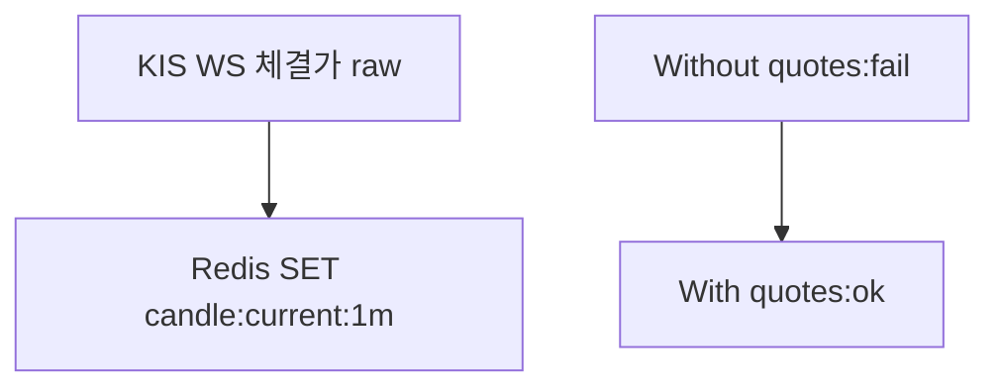
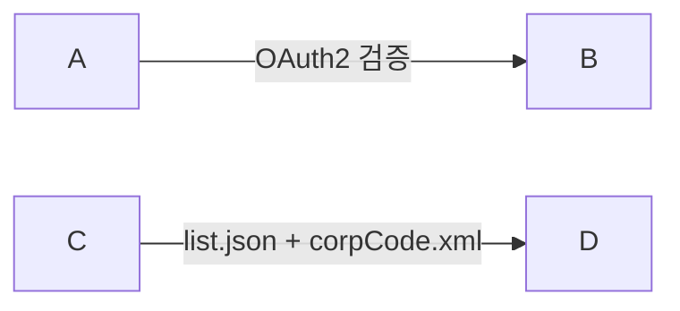
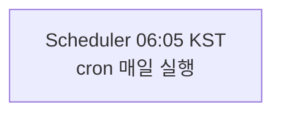

# Mermaid 작성 규약 — 현행 권위 (mermaid 10 호환)

> **권위**: 본 문서 + `scripts/fix-mermaid-syntax.mjs` 자동 변환 룰.
> **결정 이력**: PR #242 (syntax fix 도입), ADR-0052 (baseline cycle)
> **마지막 갱신**: 2026-05-08 (Living Policy 분리)

---

## 현행 규약

mermaid 10.6.1에서 한글·특수문자 처리가 엄격. 다음 4 룰 의무:

### 1. 노드 라벨 따옴표 (flowchart/graph)

콜론·슬래시·등호·공백·한글 들어가면 **따옴표 필수**:



### 2. dotted edge label (flowchart/graph)

`-.label.->` 안에 점·슬래시·한글 mix → **fail**. solid edge로 변환:



(`-.text.->` 형식은 점 없는 짧은 영문 label만 허용)

### 3. sequence message text 따옴표 비대칭 금지

```
%% ❌ 금지
A->>B: getCandles("code, "1d", before, 200")

%% ✅ OK
A->>B: getCandles(code, 1d, before, 200)
```

### 4. participant alias 단순화

괄호·콜론·슬래시 들어간 alias는 underscore로:

```
%% ❌ 금지
participant KISWS as KIS WS (ops.koreainvestment.com:21000)

%% ✅ OK
participant KISWS as KIS_WS_H0STCNT0
```

### 5. `\n` 줄바꿈 → `<br/>`

라벨 안 줄바꿈은 mermaid 10에서 `<br/>` 권장:



---

## 자동 변환 (`scripts/fix-mermaid-syntax.mjs`)

baseline 작성 후 한 줄로 일괄 정정:

```bash
node scripts/fix-mermaid-syntax.mjs
```

diagram type(`flowchart`·`graph`·`sequenceDiagram`) 자동 식별 후 분기 처리. sequence message text가 flowchart 정규식에 잘못 매치되는 부작용 회피.

## HTML 시각화

mermaid 코드 그대로는 텍스트. 그림으로 보려면:

```bash
node scripts/baseline-to-html.mjs
open _workspace/baseline/<version>/html/index.html
```

marked + mermaid CDN 클라이언트 사이드 렌더링. 의존성 0.

또는 GitHub 웹뷰 (`.md` 자동 렌더링).

---

## 적용 위치

- `_workspace/baseline/<version>/*.md` — Mermaid 다이어그램 본체
- `scripts/fix-mermaid-syntax.mjs` — 자동 변환 룰 4건
- `scripts/baseline-to-html.mjs` — HTML 변환

---

## 변경 이력

- 2026-05-08: Living Policy로 분리 (ADR-0053, PR #248)
- 2026-05-08: 4 변환 룰 도입 (PR #242, baseline v3.1.0 작성 후 fail 다이어그램 다수 정정)
