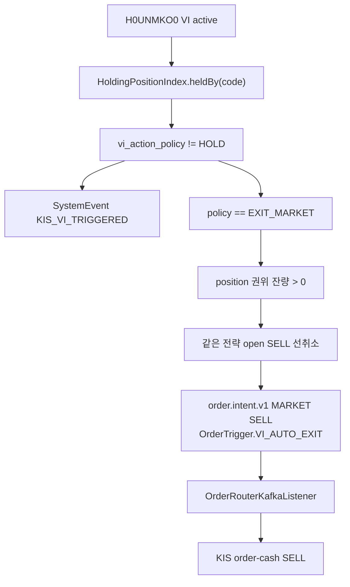

# 주문 정책 운영 가이드

> 기준일: 2026-06-13
> 범위: 자동매매 주문 발행, 보유 포지션 감시, KIS WebSocket 기반 긴급 청산 정책.

## VI 발동 정책

`H0UNMKO0` 통합 장운영/VI WebSocket은 보유 포지션 중 VI 정책이 `HOLD`가 아닌 종목만 구독한다. 주문 발행 여부는 전략별 `vi_action_policy`가 결정한다.

KIS 공식 `market_status_total` 예제의 column 목록에는 종목코드가 없으므로, handler는 payload 안에 6자리 종목코드가 있거나 단일 종목만 구독 중일 때만 이벤트를 귀속한다. 여러 종목 구독 중이고 payload에 종목코드가 없으면 오판 청산을 막기 위해 안전하게 skip한다.

| 정책 | 구독 | VI 알림 | 주문 |
|---|---:|---:|---|
| `EXIT_MARKET` | 예 | 예 | 같은 전략 보유분 시장가 SELL |
| `ALERT_ONLY` | 예 | 예 | 없음 |
| `HOLD` | 아니오 | 없음 | 없음 |

기본 정책은 전략명 기준으로 보수적으로 적용한다.

| 전략 성격 | 기본값 | 이유 |
|---|---|---|
| `DAYTRADE`, `SCALPING` | `EXIT_MARKET` | 장중 변동성 급등 시 탈출 우선 |
| `SWING`, `POSITION` | `HOLD` | VI 자체가 매도 조건이 아닐 수 있음 |
| 분류 불명 | `ALERT_ONLY` | 자본 행동 없이 관측만 수행 |

## 구독 해제 기준

VI 구독은 주문 intent를 발행했다고 바로 해제하지 않는다. 구독 해제는 `HoldingPositionIndex` 권위 snapshot이 갱신된 뒤 다음 조건 중 하나가 성립할 때 diff로 수행한다.

| 조건 | 처리 |
|---|---|
| 해당 종목의 정책 대상 보유분이 0 | `H0UNMKO0` unsubscribe |
| 해당 종목의 모든 보유 전략 정책이 `HOLD` | `H0UNMKO0` unsubscribe |
| `EXIT_MARKET`와 `ALERT_ONLY` 보유분이 하나라도 남음 | subscribe 유지 |

이 기준은 부분체결, 취소, 거절, reconcile 공백 사이에 VI 관측이 끊기는 것을 피하기 위한 운영 원칙이다.

## 자동 시장가 청산 흐름

`ALERT_ONLY`는 `KIS_VI_TRIGGERED` 운영 이벤트까지만 남기고 주문 경로로 들어가지 않는다. `HOLD`는 구독 자체를 하지 않으므로 VI 이벤트를 주문 조건으로 사용하지 않는다.
